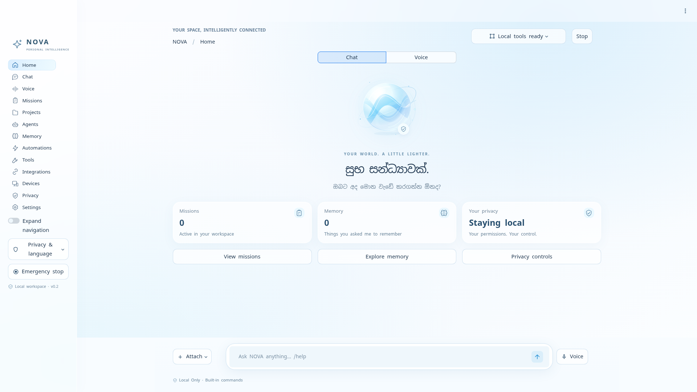

# NOVA Glass — personal AI workspace

A working **v0.2 release** following the [NOVA v8 master specification](docs/NOVA_MASTER_SPEC.md). The white-glass desktop interface connects to the existing local agent core: Sinhala-aware chat, memory, missions, safe file tools and optional AI providers. The complete v8 operating-system vision is a staged roadmap, not a completed product.



## Start on your Windows PC

1. Install **Python 3.11 or newer** from [python.org](https://www.python.org/downloads/), if it is not already installed.
2. Open this project folder and double-click **Start Nova.bat**.
3. The first launch installs dependencies automatically and opens a **native desktop window on Windows** when pywebview and Microsoft WebView2 are available. If native mode cannot start, Nova explains the issue and opens the same interface in your browser.
4. Keep the console open while using Nova. Closing the native window shuts down its owned dashboard process. In browser mode, press **Ctrl+C** in the console to stop it.

You do not need to edit JSON or create a Python environment manually. Internet is needed to install dependencies the first time. Later launches reuse them. The launcher uses port **8502**, listens only on your own computer, and keeps Streamlit's CORS/XSRF protections enabled. Native Windows window behavior has automated mocked coverage and still needs testing on a real Windows PC. Actual process startup, health, shutdown, relaunch and the complete browser interface were tested on Linux.

On Linux/macOS, run `sh start-nova.sh`. To force browser mode on Windows, run `python scripts/run_nova.py --browser`. Developers with dependencies installed can run `python -m streamlit run nova_app.py --server.address 127.0.0.1 --server.port 8502 --browser.gatherUsageStats false`.

## Try it now

Open **Chat** and try:

```text
/help
/remember language = Sinhala
/recall
/write notes.txt | අද කළ යුතු වැඩ
/files
/read notes.txt
/status
Nova stop
Nova resume
```

File commands queue real work. Open **Missions** and select **Refresh mission status** to see the verified result. The dashboard shows your workspace location. Files stay in that dedicated folder; Nova cannot select arbitrary folders on your PC in this release.

In **Missions**, enter `/write welcome.txt | ආයුබෝවන්!`, select **Prepare plan**, review it, and select **Run prepared plan**. Preparation never writes a file. Existing files are never overwritten. **Undo file write** moves an unchanged generated file to Nova's local trash; it refuses if you edited the file afterward.

## Connect an AI model

Built-in commands work immediately without an AI connection. Free-form conversation and natural-language planning require a provider:

- **Local Ollama:** install [Ollama](https://ollama.com/), download a model using its app, and keep it running. In Nova **Settings**, select **Ollama (local)** and enter the exact installed model name. Default endpoint: `127.0.0.1:11434`. Sinhala quality depends on your chosen model.
- **Groq:** in **Settings**, select **Groq (cloud)** and enter your own key into the password field. Select **NORMAL** privacy mode and explicitly classify the request **PUBLIC** or **INTERNAL**. Only then can a request leave your computer. Alternatively supply `GROQ_API_KEY` through a secure process environment.

Keys entered in Settings stay in the current Streamlit session, are not written to the database, and can be cleared there. Provider settings are session-local. The `.env.example` is documentation, not an automatically loaded secret file. The old app's embedded key is never used by the new agent.

Cloud requests receive the current prompt and fixed system instructions only. Nova does not automatically send saved memory, mission history, or files to a model. Model answers are conversational text, not executed commands. A generated mission queries the installed capability registry, must pass the tool allowlist, and is reviewed before execution. Missing capabilities are reported without scheduling a misleading partial result. Built-in commands remain shortcuts; natural-language planning uses the selected model rather than an exact-phrase command list. Live model inference was not tested in this environment; provider tests use mocked HTTP responses.

## Explore the new interface

- **Home:** the original glass orb, a Sinhala greeting, actual mission/memory counts, and a floating composer.
- **Chat / Voice:** switch modes with the pill control. Voice says **not connected**; its optional visual preview never opens a microphone or executes sample text.
- **Missions:** filter running/queued/waiting/completed work, inspect verified results, and review a local-action approval dialog.
- **Projects:** open the actual local workspace; named project management is marked coming soon.
- **Agents / Tools:** inspect installed workers, their permissions, measured recent reliability, and capability metadata.
- **Privacy:** change local-only protection and inspect the limited history of successful cloud responses. It is not a system-wide network monitor.
- **Settings → Appearance:** persist glass intensity, transparency, blur, scale, animations and performance mode locally.
- **Attach:** import UTF-8 text into the workspace through a reviewed file-creation plan. Image/PDF/screenshot/folder/clipboard actions are visibly disabled.

All 13 navigation destinations are available. Missing automation, device, speech and external service backends remain honestly disconnected. The latest reference upload contained text only; the original glass artwork follows its written visual direction.

## Data and privacy

Windows defaults to `%LOCALAPPDATA%\NovaAgent`; Linux/macOS defaults to `~/.local/share/NovaAgent`. `NOVA_DATA_DIR` can select another local folder. This folder contains SQLite state, the workspace, runtime lock, and rollback trash. Stop Nova before copying the **entire data folder** for a manual backup.

Memory is explicit: you choose what to save and can forget it in **Memory**. New explicit preferences override old ones; inferred preferences cannot replace explicit ones. Memory and mission content are local **unencrypted SQLite data**, so protect your OS account and disk. Forgetting removes a live memory row; this is not forensic secure erasure of backups or SQLite pages. Secure vault, automatic backup/restore, and full privacy redaction are later milestones. Do not store credentials in chat or memory. Common credential formats are rejected, but detection is heuristic.

Emergency stop persists across restarts and pauses queued work. An atomic operation already in progress may finish and record its actual result. Restart retries interrupted read-only missions; interrupted writes are **BLOCKED** for inspection rather than silently repeated. Independently submitted missions run on up to three workers. Steps in one prepared plan run sequentially, and a failed prerequisite blocks its dependents.

## What is available

| Capability | Status |
| --- | --- |
| White-glass Home, Chat, Missions, Memory, Privacy and Settings | Working; tested |
| Orb states, Chat/Voice switch, appearance controls, reduced motion | Working; voice animation preview is explicitly simulated |
| Projects, Agents, Tools and integration status views | Connected to existing workspace/agents; future services clearly disconnected |
| Native Windows window + browser fallback | Implemented; Windows calls tested with mocks, real Windows test pending |
| Sinhala text and selected Sinhala/Singlish commands | Working; tested; not general language understanding without a model |
| File listing, UTF-8 reading/creation, system info | Working in Nova's workspace |
| Concurrent missions, durable stop, recovery, verified file receipts | Working; tested |
| File/system specialist workers and reviewed AI plans | Implemented; deterministic tools tested; live AI planning unverified |
| Ollama and Groq adapters | Implemented; mocked HTTP tests; need a running model or your key |
| Voice, wake word, natural Sinhala speech | Not implemented |
| Windows UI control, browser control, Office, email, payments, smart home | Not implemented |
| Self-updates, plugin sandbox, encrypted vault, native installer | Not implemented |

This is a modular monolith, not the complete autonomous operating system in the specification. [Requirement status](docs/REQUIREMENTS_STATUS.md) distinguishes working, partial and not-started v8 requirements. See [project status](docs/PROJECT_STATUS.md) for the next milestones and [architecture](docs/architecture.md) for design details.

## Development and tests

```sh
python -m pip install -r nova-requirements.txt
python -m unittest discover -s tests -v
```

The suite covers functional tools, concurrency, recovery, permissions, credential handling, mocked providers, and a real-core Streamlit interaction workflow. It uses isolated temporary data folders and no live model calls. Existing `app.py` and `requirements.txt` remain the legacy app; start the new agent through **Start Nova.bat** or `nova_app.py`.

## Release packaging

`python scripts/package_release.py` creates `downloads/Nova-agent-v0.2.zip` from an explicit source allowlist, verifies the ZIP, and checks high-confidence credential formats. It excludes legacy `app.py`, runtime data, virtual environments and previous archives. This narrow scanner is not a full repository secret audit.
